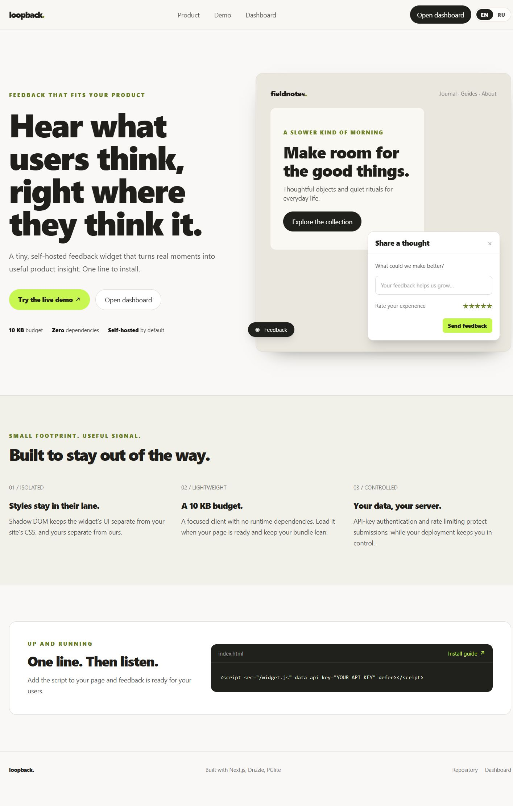
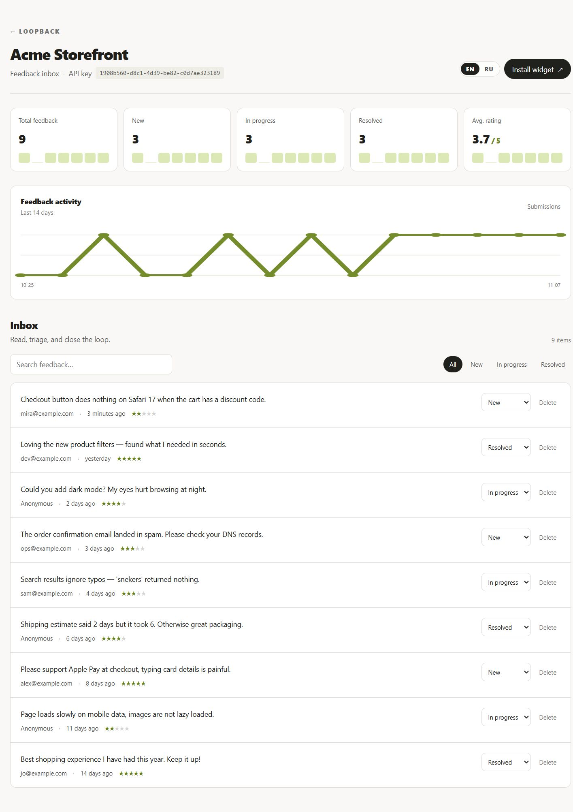
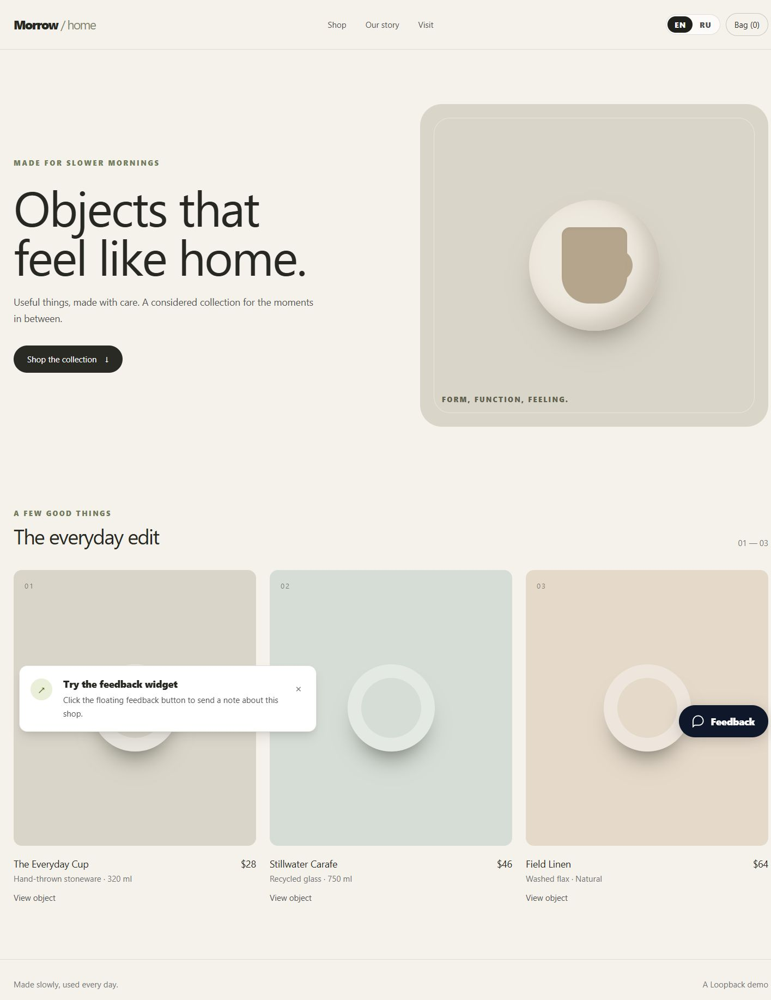
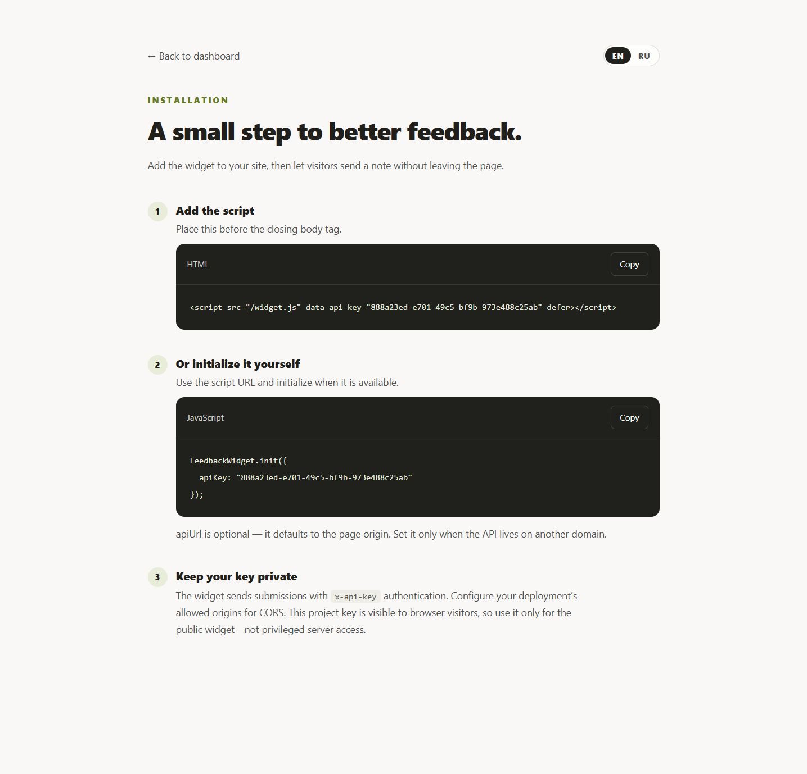
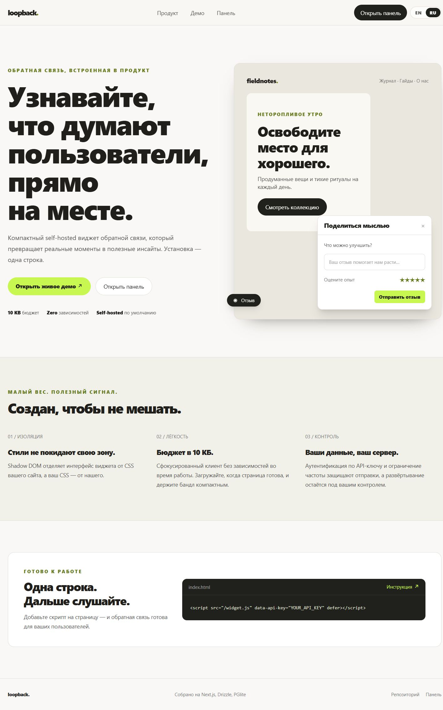
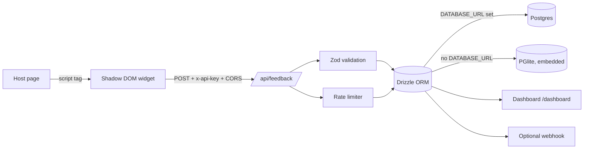

# Loopback

**In-app feedback collection that ships in one line.** A self-hosted feedback widget, ingestion API, and triage dashboard — built as a small, readable monorepo instead of a black-box SaaS.

Runs with **zero external services**: an embedded Postgres (PGlite) is used when no `DATABASE_URL` is set, and the demo workspace is seeded on first run.

```html
<script src="/widget.js" data-api-key="YOUR_API_KEY" defer></script>
```

---

## What is in the box

| Piece | What it does |
| --- | --- |
| `apps/widget` | Dependency-free `< 5 KB` gzipped widget (EN/RU). Shadow DOM, accessible dialog, star rating, inline validation, keyboard support. |
| `apps/web` | Next.js 15 App Router app: landing page, feedback inbox, install guide, and a demo storefront. Bilingual UI (English/Russian) with a cookie-persisted switcher. |
| `apps/web/app/api/feedback` | Public ingestion endpoint: API-key auth, Zod validation, per-IP and per-project rate limiting, CORS. |
| `packages/database` | Drizzle schema, connection layer with hosted-Postgres/embedded-PGlite swap, demo seeding. |
| `packages/ui`, `packages/config` | Shared UI and TypeScript configuration. |

## Screenshots

| Landing | Inbox |
| --- | --- |
|  |  |

| Demo storefront + widget | Install guide |
| --- | --- |
|  |  |

The same landing page with the interface switched to Russian (`landing-ru.jpg`):



## Quick start

Requirements: Node.js 20+ and pnpm 9+ (`corepack enable`).

```bash
corepack pnpm install
corepack pnpm build:widget   # emits apps/web/public/widget.js
corepack pnpm dev            # http://localhost:3000
```

Then open:

- `/` — landing page
- `/dashboard` — inbox with seeded feedback (created on first visit)
- `/demo` — a mock storefront with the real widget installed
- `/dashboard/install` — install snippet with the project API key

To pre-seed the database and print the API key without starting the app:

```bash
corepack pnpm db:seed
```

### Using a hosted Postgres

```bash
cp .env.example .env            # set DATABASE_URL
corepack pnpm --filter @feedback-widget/database db:migrate
```

Migrations live in `packages/database/drizzle` and are generated with Drizzle Kit.

## API

### `POST /api/feedback`

Headers: `Content-Type: application/json`, `x-api-key: <project api key>`

```bash
# `corepack pnpm db:seed` prints the demo project key
curl -X POST http://localhost:3000/api/feedback \
  -H 'Content-Type: application/json' \
  -H "x-api-key: $API_KEY" \
  -d '{"message":"Checkout is broken on Safari","email":"user@example.com","rating":2}'
```

```json
{ "id": "001f3ea0-…", "createdAt": "2026-11-07T05:21:14.609Z", "status": "new" }
```

| Status | Meaning |
| --- | --- |
| `201` | Feedback stored |
| `400` | Invalid JSON or payload (`issues[]` explains each field) |
| `401` | Missing or unknown API key |
| `429` | Rate limit hit (10 requests/minute per IP and per project) |
| `500` | Unexpected server error |

`OPTIONS /api/feedback` returns CORS headers for browser widgets on other origins.

### `GET /api/health`

Liveness probe: `{ "status": "ok", "database": "pglite" | "postgres", "timestamp": "…" }`.

## Widget options

```ts
import { init } from "@feedback-widget/widget";

init({
  apiKey: "…",                     // required, public project key
  apiUrl: "https://feedback.acme.dev", // defaults to window.location.origin
  position: "bottom-right",        // or "bottom-left"
  accentColor: "#c8f751",
  title: "Share feedback",
  locale: "en",                    // "en" | "ru"
});
```

The IIFE build exposes the same function as `window.FeedbackWidget.init(...)` and auto-initializes when a script tag carries `data-api-key` (and optional `data-locale`).

## Localization

The app ships with English and Russian dictionaries in `apps/web/messages`. The switcher writes a `loopback_locale` cookie (`en` | `ru`); server components read it on each request, so no route segments change and deep links stay stable. Date and number formatting follows the active locale via `Intl`.

The widget has its own tiny string table (it must stay dependency-free): pass `locale: "ru"` to `init`, or `data-locale="ru"` on the script tag.

## Architecture



## Design decisions

**Embedded Postgres instead of an in-memory fake.** PGlite speaks real Postgres, so the same Drizzle schema, `jsonb`, enums, and migration files work locally and in production. No second schema to keep in sync.

**Shadow DOM for the widget.** Host sites have opinions about `button`, `*`, and `z-index`. Shadow DOM plus `:host { all: initial }` makes the widget immune to both directions of CSS leakage.

**In-memory rate limiting.** Deliberately simple: one `Map`, sliding window, no Redis. It is per-process, so a multi-instance deployment needs a shared store — called out in the roadmap rather than hidden.

**Demo workspace, not auth.** The dashboard provisions a demo user/project on first request so the repo is runnable in one command. Production auth (sessions, per-user projects) is the next milestone, not pretended to exist.

**Cookie locale instead of `/[locale]` routes.** The interface is a preference, not content: a cookie keeps existing deep links (`/dashboard?status=new`) valid, avoids duplicating every route, and still lets server components render the right dictionary on the first paint. URLs would be the better choice for SEO-driven marketing pages.

**Server Actions for triage.** Status changes and deletes are mutations, not REST resources; Server Actions keep the client bundle small and let Next.js revalidate the inbox.

## Verification

```bash
corepack pnpm lint                      # tsc --noEmit across the workspace
corepack pnpm --filter @feedback-widget/widget build
corepack pnpm --filter @feedback-widget/web build
node scripts/smoke.mjs                  # API contract checks against a running server
```

`scripts/smoke.mjs` asserts 201/400/401/429/500 behaviour and CORS preflight, using `BASE_URL` and `API_KEY` from the environment.

## Roadmap

- [ ] Session auth and multi-project switching
- [ ] Redis-backed rate limiting for multi-instance deployments
- [ ] Webhook UI + HMAC signatures
- [ ] Screenshot/browser metadata in feedback payloads
- [ ] Playwright E2E suite in CI

## License

MIT
